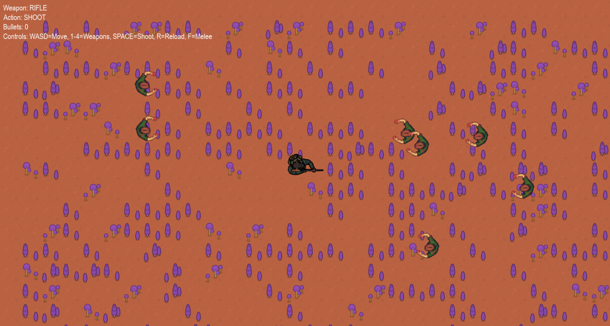

# Zombie Survival Shooter

A top-down 2D survival shooter built with **Python and Pygame**. You play a lone survivor in the
middle of a procedurally generated sci-fi wasteland while waves of zombies close in from both sides.
Switch between four weapons, shoot, reload and melee to stay alive.



## Features

- **Animated player** with four weapons (rifle, shotgun, handgun, knife), each with its own
  idle / move / shoot / reload / melee sprite animations
- **Enemy AI**: zombies spawn every second from the left or right edge, chase the player and
  switch to an attack animation when in range; each takes two hits to kill
- **Procedural map**: a new tile map is generated every run from weighted random tiles, with a
  walled border and a clear area in the centre
- **Projectile system** with fire-rate cooldown, range limit and bullet/enemy collision
- **Sound**: background music plus shoot, hit and death effects

## Controls

| Key | Action |
|---|---|
| `W` `A` `S` `D` | Move |
| `Space` | Shoot |
| `R` | Reload |
| `F` | Melee attack |
| `1` `2` `3` `4` | Rifle / Shotgun / Handgun / Knife |
| `M` | Toggle music |

## Getting started

Requires Python 3.9+.

```bash
git clone https://github.com/ahmedayadeng-lang/zombie-survival-shooter.git
cd zombie-survival-shooter
pip install -r requirements.txt
python main.py
```

The window is 1920×1030 by default. Change `SCREEN_WIDTH` / `SCREEN_HEIGHT` in
[`settings.py`](settings.py) for smaller screens.

## Project structure

```
├── main.py            # Game loop: events, spawning, update, draw
├── settings.py        # Screen size, asset paths, game-state enums
├── player.py          # Survivor class (movement, weapons, animations) and Bullet class
├── skeleton.py        # Zombie enemy: chase / attack AI, health, animations
├── game_map.py        # Procedural tile-map generation and rendering
├── audio_manager.py   # Music and sound-effect loading/playback
└── assets/
    ├── Top_Down_Survivor/   # Player sprite animations per weapon
    ├── skeleton move/       # Zombie walk animation
    ├── skeleton attack/     # Zombie attack animation
    ├── map/Tile/            # Map tiles
    ├── audio/               # Music and sound effects
    └── bullet.png
```

## Credits

- Map tiles: [RTS Pack: Sci-Fi](https://kenney.nl) by Kenney (CC0)
- Player and zombie sprite animations: free sprite packs from [OpenGameArt.org](https://opengameart.org).
  All rights remain with their original authors.
